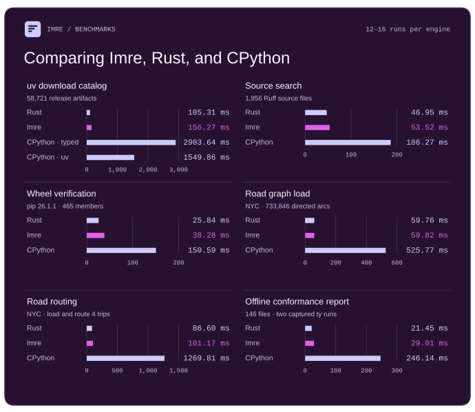
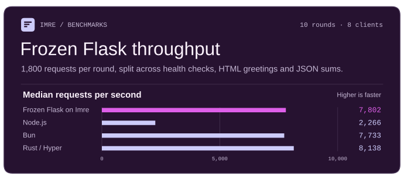

#  Imre

An experimental ahead-of-time compiler for typed Python, written in Rust.

> [!WARNING]
> This README includes human edits; all code changes, PR summaries, and additional
> documentation were authored entirely by GPT-6 Astra in [Codex](https://openai.com/codex/).
>
> Imre implements only a small part of Python and its standard library,
> with no guarantee of future development or maintenance. Use at your own risk.

## Benchmarks

<p align="center">
  
</p>

Each CLI runs on one AMD EPYC Milan vCPU with warm filesystem caches. Imre and
CPython run the same Python. The catalog includes uv’s original implementation
as a second CPython reference. Road routing includes reading the graph and
finding all four distances.
[Workloads, raw samples and reproduction steps](benchmarks/applications/README.md)

<p align="center">
  
</p>

The Flask benchmark issues health checks, escaped HTML greetings and JSON sums
over loopback. Each bar is the median of 70 rounds at eight concurrent clients.
Frozen Flask on Imre 0.1.5 compiles its routes and Jinja template
ahead of time. Stock Flask on CPython uses Werkzeug. Rust/Hyper
implements the same routes directly. [HTTP workload and results](benchmarks/applications/README.md#flask)

## Hello, world!

```python
# hello.py
def greet(name: str) -> str:
    return f"Hello, {name}!"


print(greet("world"))
```

On Apple Silicon macOS or 64-bit Linux, build and run the executable.

```console
$ imre build hello.py
$ ./hello
Hello, world!
```

Or run directly, as native code:

```console
$ imre hello.py
Hello, world!
$ imre -I -B -c 'import sys; print(sys.implementation.name)'
imre
$ uv python find imre
/path/to/bin/imre
$ uv run --python imre hello.py
Hello, world!
```

## Language support

Imre compiles a restricted subset of Python into native executables that run
without a Python installation. This program prints the names of everyone who
scored at least eight points, in alphabetical order.

```python
from dataclasses import dataclass


@dataclass
class Result:
    name: str
    score: int


def finalists(results: list[Result], cutoff: int) -> list[str]:
    return sorted(result.name for result in results if result.score >= cutoff)


results = [Result("Mira", 8), Result("Jo", 4), Result("Ada", 10)]
print(", ".join(finalists(results, 8)))  # Ada, Mira
```

Imre can resolve `result.name` and `result.score` at compile time. If you add
the loop below, `imre build` reports an error at `getattr`. Running the same
module with `imre -m` supports this lookup and prints `Mira` and `8`, as
CPython does.

```python
for field in ["name", "score"]:
    print(getattr(results[0], field))
```

A function with a fixed signature cannot currently call itself. An async
generator can feed an async comprehension. See the [language subset](docs/subset.md)
for details on supported operations, and [module coverage](docs/stdlib.md) for
the standard library.

At the same time, Imre is capable of running scripts like
[ty’s conformance report](examples/conformance_report/README.md) unchanged,
with Rust-competitive performance.

## Standard library test results

Across the 45 standard library module families below, **13,166 of 16,225 tests (81.15%)** have recorded paired passes.
The paired pass rate is 80.1% (10,679 of 13,327) for the original 25 families and 85.8% (2,487 of 2,898) for the 20 additional families.
A **paired pass** means that CPython 3.14.5 passed the original test and Imre passed it at both
`-O0` and `-O3`. The total combines focused and intact suite runs across revisions, including
development branches. The intact `dataclasses` run at `143809dd` replaces that family’s earlier count. Each original test occurrence counts once. Skipped and omitted tests remain
in the denominator. The [omission decisions](docs/stdlib-omissions.md) cover 118 originals in these 45 families and [eight supplemental Decimal originals](docs/stdlib-omissions.md#decimal).
The published totals at `58276705` include typed native code, boxed native code that calls the runtime, and earlier runs through the retired Python source evaluator. Use the recorded product and launch mode when reproducing a row. [Compiler design](docs/design.md#emitting-operations) · [Evaluator removal](https://github.com/astral-experiments/imre/pull/6309)

A later Linux recheck covered 155 previously credited tests. CPython passed all 155. At both native optimization levels, 136 `importlib` tests failed in setup while loading temporary disk or ZIP packages, and seven failed inside the test method while loading a temporary module. The twelve `logging.config.fileConfig` originals reported native errors at both levels and have been removed from the paired total. [Per-test results](benchmarks/cpython_stdlib/paired-recheck-6814.tsv) · [Imre revision](https://github.com/astral-experiments/imre/commit/6f4b1f67bea8024ea216bae84194edc26b7534ed)

On public #6856, stock CPython passed all 143 previously credited `importlib` originals in the named selection. Imre entered all 143 methods at each tier and passed the same 138 at `-O0` and `-O3`. These include the five originals previously verified with empty package initializers. Physical byte captures confirmed empty Python source in 6 passing disk cases and 6 passing ZIP cases, including both `test_module_resources` fixtures. In 5 originals, both native tiers found the requested nonempty source and raised `NotImplementedError` inside the test method because no compiled body was available. [Per-occurrence results](benchmarks/cpython_stdlib/importlib-recheck-6856.tsv) · [Measured revision](https://github.com/astral-experiments/imre/commit/b506bfc0b03cfb17ee0373b91dc3b6b3f559a9bd)

The [supplemental `test_urllib2` decision](docs/stdlib-omissions.md#test_urllib2) covers the single packaging-specific error in a separate 80-case replay.

On the campaign's x86-64 Linux runner, stock CPython 3.14.5 registered **16,191** of the **16,202** originals in the earlier 44 families. It passed **15,161**, skipped 1,023, and reported 7 errors. Of the 13,148 paired originals in that cohort, **13,050** passed in that stock run. The other 98 skipped or recorded an error.

The separate Linux `netrc` run added 22 stock passes, all paired, and one WASI skip. Together the two stock measurements registered 16,214 originals, with 15,183 passes, 1,024 skips, and 7 errors. Across the 45 families, **13,068 of the 15,183 stock Linux passes (86.1%)** have paired passes, leaving **597** more to reach 90%. [Frozen stock and paired counts by family](benchmarks/cpython_stdlib/full/frozen-stock-intersection-7320.tsv)

| Module | Paired passes | Upstream tests | Omitted | How the tests ran |
| --- | ---: | ---: | ---: | --- |
| `argparse` | 1,887 | 1,893 | 6 | Across public revisions, 1,887 original tests have paired passes, including the translation test that produced 32 messages. In the intact [#6849 run](https://github.com/astral-experiments/imre/pull/6849), CPython 3.14.5 passed all 1,893. With `test.test_argparse` declared, O0 and O3 each passed 1,883 and skipped none. Both failed `TestProgName.test_module`, `TestProgName.test_package` and `TestTranslations.test_translations`. Both errored on `TestEncoding.test_argparse_module_encoding` and the six historically omitted compiled-entry methods in `TestProgName` (`test_directory_compiled`, `test_directory_in_zipfile_compiled`, `test_module_compiled`, `test_package_compiled`, `test_script_compiled` and `test_zipfile_compiled`). |
| `collections` | 639 | 659 | 9 | The async-generator ABC original passed on public #4804. All 40 originals in that ABC cohort now have a paired result or an individual omission decision. On #6309 and #6368, `TestChainMap.test_basics` and `TestCounter.test_copying` errored in `eval(repr(...))` at both native levels before the later suite timeouts. |
| `csv` | 122 | 128 | 2 | The full suite passed 124/128 on stock and 122/128 at O0 and O3. Four cases skipped on all three engines. Two additional CPython-only cases skipped on Imre. |
| `dataclasses` | 273 | 276 | 1 | At `143809dd`, the intact suite recorded 273 passes, two CPython-only skips and one error at each of O0 and O3. In `TestDocString.test_docstring_with_unsolvable_forward_ref_in_init`, the upstream `exec(textwrap.dedent(...), ns)` raised `NotImplementedError`. All five subtests that check collection of the original slotted class passed. [Upstream test](https://github.com/python/cpython/blob/5607950ef232dad16d75c0cf53101d9649d89115/Lib/test/test_dataclasses/__init__.py#L2371-L2387) · [Class and field identity](https://github.com/astral-experiments/imre/pull/5979) |
| `datetime` | 1,029 | 1,098 | 21 | Four unchanged Fast date and datetime constructor parents passed public #4751 at O0 and O3. In their recorded selections, nine round-trip originals and two timezone representation originals passed on stock and errored in `eval` at both native levels on #6309 and #6368. Stock passed the matching four in its six-parent group. Three additional [round-trip tests](benchmarks/cpython_stdlib/datetime-recheck-6844.tsv) passed on #6308. On #6844, their original launchers reached `eval(s)` on a runtime-generated representation and errored at both native levels. The [21 omissions](docs/stdlib-omissions.md#datetime) cover CPython C API requirements. [Two extension-module tests](docs/stdlib-omissions.md#datetime-extension-module-tests) remain in scope. |
| `fnmatch` | 24 | 24 | 0 | Complete suite on `main`, all 24 passed. |
| `functools` | 316 | 329 | 2 | With the native `_functools` provider, the earlier 325-method run recorded 315 passes, seven errors and three skips. The shared reduce implementation added the original Python reduce-initializer test when the initializer was supplied by keyword. [#5850](https://github.com/astral-experiments/imre/pull/5850) · [#5890](https://github.com/astral-experiments/imre/pull/5890) |
| `hashlib` | 78 | 82 | 0 | Under default resources, 67 of 69 stock passes paired on Imre. Of those, 66 were already among the 77 resource-enabled pairs. The [earlier public replay](benchmarks/cpython_stdlib/full/hashlib/README.md#ordinary-stock-replay-at-7f886453) supplies the additional pair, `HashLibTestCase.test_hash_disallow_instantiation`, giving 78 distinct pairs across policies. Both default native runs skipped 14 tests and errored in `test_threaded_hashing`. |
| `importlib` | 432 | 1,345 | 34 | An earlier run across eight modules recorded 78 additional resource passes. Sixty-five needed the pinned `zipfile` on the runtime path, and 13 also needed it during compilation. The [six omissions](docs/stdlib-omissions.md#importlib) cover two bytecode-only resource fixtures and four CPython multi-phase extension tests. The Linux roster contains 1,345 original tests. The Windows registry module requires winreg and skips during Linux discovery. Seventeen previously credited metadata tests passed at both levels on #6309 and #6368 with their wheel and egg fixture package declared. `FileSystem.test_unicode_dir_on_sys_path` passed at both levels on #6367. On #6368 and #6376 it raised `FileNotFoundError` while creating its Unicode directory at both levels. The original passed again at both levels on [#6378](https://github.com/astral-experiments/imre/pull/6378). The #6856 recheck removed 5 earlier credits. |
| `io` | 959 | 1,038 | 4 | An intact module run reproduced 948 pairs. Later selections added a closed-stream case and `CIOTest.test_flush_error_on_close`. A rejecting buffered flush preserved its exception and left the real file empty. At `b6c2a714`, the C and Python incremental newline decoder tests passed, along with `PyTextIOWrapperTest.test_encoded_writes` and `PyTextIOWrapperTest.test_newlines`. The complete 1,038-occurrence selection reproduced all 954 earlier pairs and added `COtherFileTests.testDefaultBufferSize`, which checks the length returned by `read1()` using the block size from `f.raw`. Beyond those 955 pairs, `CTextIOWrapperTest.test_uninitialized` (occurrence 1) passed on stock and at O0 and O3 in a five-test selection on `9e078380`. Both native tiers on its #7040 parent raised `AttributeError` at `TextIOWrapper.__new__`. From that subtotal of 956, the C and Python `TextIOWrapperTest.test_multibyte_seek_and_tell` originals (frozen rows 719 and 795, each occurrence 1) passed on stock and both tiers of `1fa13650`. Each wrote eight EUC-JP bytes, sought back to byte 3, and reread the Japanese line. The earlier eight-test O0 selection on #7116 timed out after 480 seconds in the separately credited `PyTextIOWrapperTest.test_seek_and_tell`. On public #7306, stock CPython and both native tiers passed `CTextIOWrapperTest.test_initialization` (frozen row 704, occurrence 1). After reinitialization rejected an invalid newline, reading the wrapper raised `ValueError`. The saved executables also passed with the entry and staged test sources withdrawn. Five previously credited controls passed again. [Intact run](https://github.com/astral-experiments/imre/pull/5867) · [Closed stream](https://github.com/astral-experiments/imre/pull/5920) · [Buffered flush](https://github.com/astral-experiments/imre/pull/5997) · [Owning FileIO](https://github.com/astral-experiments/imre/pull/6343) · [TextIOWrapper allocation](https://github.com/astral-experiments/imre/pull/7063) · [Occurrence results](benchmarks/cpython_stdlib/full/io-textiowrapper-allocation-7063.tsv) · [EUC-JP text streams](https://github.com/astral-experiments/imre/pull/7135) · [Seek/tell occurrences](benchmarks/cpython_stdlib/full/io-euc-jp-text-cookies-7135.tsv) · [Reinitialization fix](https://github.com/astral-experiments/imre/pull/7298) · [Measured revision](https://github.com/astral-experiments/imre/commit/49b7a0dbdce1d1ee3d470b474d0166822b9214c1) · [Six occurrence results](benchmarks/cpython_stdlib/full/io-textiowrapper-initialization-7306.tsv) |
| `itertools` | 111 | 138 | 10 | On #7040, declared unittest discovery of `test.test_itertools` ran all 137 primary originals. O0 and O3 each passed 111, skipped 21, errored on four and failed one. Primary stock unittest passed 133 and skipped four. Both tee deallocation tests passed, including the 20-million-item backward deletion. Of 113 earlier credits, `TestBasicOps.test_ziplongest` errored in computed `eval` and the finite `itertools.batched` docstring failed. The 138th original passed free-threaded stock and skipped before native discovery with the GIL enabled. Bare native launches started zero originals in either module. [Per-original results](benchmarks/cpython_stdlib/full/inspect-itertools-shutil-7040-occurrences.tsv) · [Earlier tee replay](https://github.com/astral-experiments/imre/commit/fd065c64ea74afac6ed5f95e7619cf83761660e5) · [Ten omission decisions](docs/stdlib-omissions.md#itertools) |
| `json` | 207 | 216 | 0 | The earlier stock and public Imre runs at O0 and O3 each ran all 216 originals in separate working directories, passed 215 and skipped the same address-space test. The one new pair was `TestPyRecursion.test_highly_nested_objects_encoding`. The separate encoder candidate added no pairs. On #7320, stock passed the C and Python variants of both `test_object_pairs_hook` and `test_object_pairs_hook_with_unicode`. Each saved O0 and O3 executable entered the original method and raised at its expected-value expression, `eval(s)`, before any hook assertion. The ordinary module runner stopped during collection. [Per-original results](benchmarks/cpython_stdlib/full/json/pairs-hook-occurrences-7320.tsv). On #6309 and #6368, both occurrences of the `json` doctest and both occurrences of `json.encoder.JSONEncoder.encode` failed at both native levels. All four also failed before the 600-second explicit-package run timed out. Earlier runs of all 34 CLI originals recorded 32 child subtests and 64 tool subprocesses per lane. The O0/O3 children ran native code. Two help cases matched the upstream usage-prefix assertion while their full stdout differed from stock. [Tested public revision](https://github.com/astral-experiments/imre/commit/af2d9fc74ef99c453a76948aeb42927712c47b87). |
| `logging` | 220 | 272 | 0 | Seven more originals passed from the full upstream logging test file in separate stock and native processes. They cover task names, formatter precision, shutdown and recursion. Twelve `ConfigFileTest` methods passed on stock and at O0 and O3 under the earlier declared launchers. The four native group runs exited 1 because other methods failed. On #6837, stock passed all twelve again. At O0 and O3, `fileConfig` errored while evaluating handler class names from configuration text in eleven methods and formatter defaults in one. A separate ordinary `dictConfig` run with resolved values matched stock at both levels. On #7178, FILE and declared-module unittest each ran all twelve and reproduced the errors at O0 and O3. [#6837 results](benchmarks/cpython_stdlib/logging-fileconfig-recheck-6837.tsv) · [#7178 per-method results and receipts](benchmarks/cpython_stdlib/logging-fileconfig-recheck-7178.md) |
| `os` | 471 | 579 | 0 | The public filesystem census verified 13 previously unrecorded pairs, including five spawn cases with real native children. Twelve passed on frozen stock. Two further originals cover Linux waitid and its child-status constants. On #7081, a named launch of `ForkTests.test_fork` passed on stock CPython 3.14.5 and on Imre at O0 and O3. Both the isolated and malloc-debug helpers used the matching native tier and waited for their own forked children to exit successfully. On #7253, `ExportsTests.test_os_all` (ordinal 80) found both `open` and `walk` in `os.__all__` in named runs at both tiers. A separate static file import stopped at `test_os.py:1116` before the method ran. [Linux waitid](https://github.com/astral-experiments/imre/pull/5985) · [Fork replay](benchmarks/cpython_stdlib/full/os/receipts/2026-11-12-fork/README.md) · [#7253 occurrences](benchmarks/cpython_stdlib/full/os-socket-statistics-7253.tsv) |
| `pathlib` | 968 | 1,369 | 1 | On #6713, both native tiers ran all 1,369 original methods after the seven test modules were linked. Stock CPython passed 978 and skipped 391 at UID 1000. O0 and O3 each passed 962, skipped 392 and errored on 15. Twelve path representation methods each had six subtest errors. Three multithreaded `Path.parts` methods errored at worker startup. Ordinary `-m unittest` stopped during import before collecting a test. An eight-hour repeat on [#6849](https://github.com/astral-experiments/imre/pull/6849) used the same staged sources and test order. O0 completed 862 cases and O3 completed 788 before the cutoff. Six owner and group cases that skipped at UID 1000 passed in an earlier UID-0 run, bringing the cumulative total to 968. [Earlier intact replay](https://github.com/astral-experiments/imre/commit/3e1a1db51d3ebea1cab66a1afb90eca9c6596d91) · [Measured revision](https://github.com/astral-experiments/imre/commit/e0a1762b35f03e2a8c83e764522e5bb8648e4f1f) |
| `re` | 146 | 165 | 7 | Seven CPython compiler and bytecode checks have explicit omissions. The 146 paired originals include focused and complete runs. On #6309 and #6368, `ExternalTests.test_re_tests` recorded 289 unsuccessful subtests at each native level. |
| `shutil` | 172 | 223 | 0 | On #7040, declared unittest discovery of `test.test_shutil` retained all 172 previous pairs. O0 and O3 each passed 172, skipped 49 and errored on the `copy_file_range` and `sendfile` variants of `test_exception_on_second_call` at `eval(self.PATCHPOINT)`. Both tiers passed `test_copystat_symlinks` and `test_copytree_retains_permissions` in the intact and selected runs. Bare native unittest started zero originals. Primary stock passed 160 and skipped 63. Secondary stock passed 172 and skipped 51. Thirteen native passes qualified only on secondary stock and two only on primary stock. [Per-original results](benchmarks/cpython_stdlib/full/inspect-itertools-shutil-7040-occurrences.tsv) · [Earlier archive evidence](https://github.com/astral-experiments/imre/pull/5899) |
| `socket` | 110 | 746 | 0 | Socket ownership and UDP-Lite add paired passes. The sendfile original was withdrawn when the descriptor fast path was reverted. At `b6c2a714`, `test_csocket_repr` checked the descriptor, family, type and protocol before and after close. The selected `GeneralModuleTests.test_pickle` passed on `2b3e6cce` after the socket reduction fix. It checks that pickling a socket raises `TypeError` and that `AF_INET` and `SOCK_STREAM` round-trip under protocols 0 through 5. In a declared 99-original selection, `GeneralModuleTests.test__sendfile_use_sendfile` errored at both levels on #6375 and passed at both on #6376. It checks the exceptions raised for a closed descriptor, an out-of-range descriptor and `None`. The intact socket run started no originals. On #7253, a declared file launch of `GeneralModuleTests.test_socket_type` passed its GC-tracking and type-immutability checks at both tiers. [Ownership](https://github.com/astral-experiments/imre/pull/6035) · [Datagrams](https://github.com/astral-experiments/imre/pull/6049) · [File transfer rollback](https://github.com/astral-experiments/imre/pull/6072) · [Socket reduction](https://github.com/astral-experiments/imre/pull/6360) · [Sendfile descriptor checks](https://github.com/astral-experiments/imre/pull/6376) · [#7253 occurrences](benchmarks/cpython_stdlib/full/os-socket-statistics-7253.tsv) |
| `subprocess` | 303 | 353 | 3 | The large-input communicate timeout used a real child at each requested native level. On public `e400ad99`, 301 of 302 parent successes met their child-execution or process assertions. The signal-race case that accepted an early compiler exit remains outside the ledger. [Measured public revision](https://github.com/astral-experiments/imre/commit/e400ad995d604f2108c031d0bf536a0d0e6c583f) |
| `tempfile` | 110 | 118 | 2 | All three runs registered the same 118 original parents. CPython passed 112 and skipped six. Public Imre passed 110 and skipped eight at both levels. |
| `textwrap` | 68 | 68 | 0 | Complete suite on `main`, all 68 passed. |
| `threading` | 97 | 228 | 1 | An earlier whole-suite run qualified 91 passes. Four subsequent shutdown and atexit cases matched their stock child output. Restoring the module’s public names added `test__all__`. The main-thread shutdown test was already passing on public. Each isolated child printed the two expected lines and exited successfully. These two results bring the cumulative ledger to 97. Two earlier passes, `test_repr_stopped` and `test_leak_without_join`, passed when prelinked and errored when loaded from disk on the same public revision. The one omission accepted an unrelated child compilation failure. [Public module and shutdown runs](https://github.com/astral-experiments/imre/commit/20ef45d4fd1f160df1de920bbb7da031ce2f558a) · [Earlier shutdown replay](https://github.com/astral-experiments/imre/commit/c047d423c21207a400beb165da196bd8b451117c). |
| `typing` | 710 | 712 | 2 | All three ordinary module runs registered 712 parents, including the same 11 doctests with 43 examples. Stock passed 712. Each native run passed 706, errored on four and skipped two. Six named successes are new to the accumulated ledger. Upstream-defined CPython-only guards skipped two tests on Imre. Both passed on stock and have [individual omission decisions](docs/stdlib-omissions.md#typing). |
| `unittest` | 1,054 | 1,090 | 0 | The matched complete suite retained its 908 passes and gained nine when native coroutines began reporting unawaited warnings. All 22 AsyncMockAssert originals passed, as did 29 async-patch and thread-mock controls. The cumulative total also includes the earlier Mock directory-listing passes. Four previously uncounted tests already passed at `b6c2a714`, covering async iteration, async `patch.dict`, autospec attachment and misspelled arguments. The call-recording hook added `MockTest.test_setting_call`, which installs a custom `__call__` and checks its recorded argument and arity. In the earlier 558-occurrence selection, 412 earlier pairs passed again, eight failed or errored on both revisions, and 118 patch tests did not register. With the upstream `uncache` helper isolated, `TestDiscovery.test_discovery_failed_discovery` passed on #6358. `assertRaises` now binds the traceback module before the test replaces `__import__`, so the test can check the expected `TypeError` message. With the upstream `uncache` helper, `TestDiscovery.test_discover_with_init_modules_that_fail_to_import` passed at both native levels on #6368. It checks the failed package import and round-trips the resulting test through every pickle protocol. The intact native discovery module registered zero of its 26 originals. `MockTest.test_assert_has_calls_nested_spec` passed on stock and at O0 and O3 on `fce3addad`. Both tiers on #7040 failed when they matched the call to `Foo(1).meth1(1, 2)` against the signature of `Foo`. With the staged test and caller sources withdrawn, the same executables failed on #7040 and passed on the fix. On #7178, `SpecSignatureTest.test_builtins` reached `create_autospec(1.0)` and failed when `dir()` tried to list the float’s attributes. The original passed on stock CPython 3.14.5 and in declared unittest runs at O0 and O3 on #7190. The same method also passed after source withdrawal on the earlier numeric fix. On #7203, `MockTest.test_spec_list_subclass`, `SpecSignatureTest.test_builtin_functions_types` and `SpecSignatureTest.test_magic_methods` each raised `NotImplementedError` when mock inspected a list subclass’s `__dict__`. All three passed on stock CPython 3.14.5 and in declared unittest runs at O0 and O3 on #7214. On #7263, both wrapped autospec originals (807 and 811) passed on stock and in named unittest runs at O0 and O3. The instance mock called the wrapped static method, and the class mock constructed a real instance. On #7292, `MockTest.test_autospec_mock` (ordinal 789) passed on stock and in named unittest runs at O0 and O3. Accessing the patched `A.B` through an autospec now identifies both the attribute and its parent mock in `InvalidSpecError`. [Earlier directory checks](https://github.com/astral-experiments/imre/pull/5995) · [Coroutine warnings](https://github.com/astral-experiments/imre/pull/6050) · [Mock call recording](https://github.com/astral-experiments/imre/pull/6340) · [Discovery traceback](https://github.com/astral-experiments/imre/pull/6358) · [Import exception pickling](https://github.com/astral-experiments/imre/pull/6368) · [Nested autospec fix](https://github.com/astral-experiments/imre/pull/7077) · [Occurrence results](benchmarks/cpython_stdlib/full/unittest-nested-autospec-7077.tsv) · [Builtin autospec results](benchmarks/cpython_stdlib/full/unittest-builtin-autospec-7190.tsv) · [List spec results](benchmarks/cpython_stdlib/full/unittest-list-spec-7214.tsv) · [Wrapped autospec occurrences](benchmarks/cpython_stdlib/full/unittest-wrapped-autospec-7263.tsv) · [Linux receipts](benchmarks/cpython_stdlib/full/unittest/receipts/wrapped-autospec-7263-linux.tar.gz) · [Mocked autospec occurrence](benchmarks/cpython_stdlib/full/unittest-autospec-mocked-member-7292.tsv) · [#7292 Linux receipts](benchmarks/cpython_stdlib/full/unittest/receipts/autospec-mocked-member-7292-linux.json) |
| `urllib` | 173 | 178 | 0 | The public ledger at `4ac5e885` records both unchanged scripts at O0 and O3 in ordinary and explicit `--runtime-imports` modes. All 178 tests matched stock in order, including 173 successful parents, three with only child outcomes, and two Windows skips. |
| **Total** | **10,679** | **13,327** | **105** | **4 complete suites matched stock in earlier public runs** [#5756](https://github.com/astral-experiments/imre/pull/5756) |

The `importlib` total includes 108 configured `test_spec` passes on public `f151647b`, 54 each for the frozen and source implementations. The ordinary native launcher registered none of them. With the unused `_testmultiphase` probe isolated, all 108 stopped in `setUp` with the default native cache tag of `None`. Setting `sys.implementation.cache_tag` to `imre-test` let all 108 unchanged methods pass on stock and at both native tiers. Separate instrumented runs recorded 470 assertions each. In a stock control with the tag set to `None` and the fixture’s cache calculation deferred, 78 originals needed no cache path and 30 requested filename metadata. None read or executed a `.pyc`. [Upstream tests](https://github.com/python/cpython/blob/5607950ef232dad16d75c0cf53101d9649d89115/Lib/test/test_importlib/test_spec.py) · [Measured revision](https://github.com/astral-experiments/imre/commit/f151647b6134630c6c316d3a6a3a1fce708f7c53)

The `unittest` total includes 118 fixture-selected `testpatch` pairs across focused and earlier module runs. The intact native launcher registered zero of the 118 original methods. The fixture supplied only the verbatim upstream `uncache` helper and its two imports as `test.test_importlib.util`. This let the unchanged test module run without the utility’s eager `_testmultiphase` import. Imre linked the upstream `package3` and `package4` test packages and their submodules. Stock passed all 118 with both the full utility and the fixture. Public #6342 already passed 115 with the fixture, and #6347 reproduced the same 115 passes and three errors at both `-O0` and `-O3`. On #6352, `PatchTest.test_property_setters` also passed at both tiers. It changes `is_local`, `target` and `temp_original` on an active patch and checks that exiting the context uses those new values. On #7216, the two remaining originals, `PatchTest.test_patch_propagates_exc_on_exit` and `PatchTest.test_stopall_lifo`, passed on stock with the documented fixture. Both passed in native FILE, saved and source-withdrawn runs at O0 and O3. With the full upstream utility, native startup stopped at its line 18 before either method ran. [Patch restoration](https://github.com/astral-experiments/imre/pull/6352) · [Upstream patch tests](https://github.com/python/cpython/blob/5607950ef232dad16d75c0cf53101d9649d89115/Lib/test/test_unittest/testmock/testpatch.py) · [Upstream utility](https://github.com/python/cpython/blob/5607950ef232dad16d75c0cf53101d9649d89115/Lib/test/test_importlib/util.py) · [#7216 source and fixture](benchmarks/cpython_stdlib/full/unittest-patch-stack-7216.md) · [Patch-stack occurrences](benchmarks/cpython_stdlib/full/unittest-patch-stack-7216.tsv)

See the [standard library coverage report](docs/stdlib.md) for the Linux test
results and import coverage recorded in this repository.

### Additional module families

CPython 3.14.5 discovers **2,898 test occurrences** across these 20 families on Linux. They use the same pairing rule and have a separate total.

| Module | Paired passes | Upstream tests | Omitted | How the tests ran |
| --- | ---: | ---: | ---: | --- |
| `base64` | 40 | 41 | 0 | Stock passed all 41 originals. Both native runs passed 40, retaining the 38 earlier passes and adding `BaseXYTestCase.test_RFC4648_test_cases` and `BaseXYTestCase.test_b16encode` (occurrence 1 each). The earlier 38 include five CLI tests for decoding, encoding from files and stdin, help, and invalid flags. Only the CPython-specific `LazyImportTest.test_lazy_import` skipped on Imre. A separate Base16 application produced identical output on stock, O0 and O3. [Public replay revision](https://github.com/astral-experiments/imre/commit/259f2ddc8e20cae1e61a0438a77be7d47b4037b1). |
| `configparser` | 339 | 344 | 0 | Stock CPython and both intact native runs passed 339 originals and skipped the same five. Both native tiers retained all 328 earlier passes. The 11 newly passing tests round-trip configparser exceptions through every pickle protocol and compare the restored state. [Earlier replay](https://github.com/astral-experiments/imre/commit/f6cb866c22d92cb976b7d7a3551e4bdac722c812) · [Exception reducer](https://github.com/astral-experiments/imre/pull/6293) · [Public replay revision](https://github.com/astral-experiments/imre/commit/1fff3d2dd7041a58b828e946579c19f820d89213). |
| `contextlib` | 149 | 149 | 0 | On Linux, CPython 3.14.5 and Imre #7095 at O0 and O3 each passed the two complete modules together (91 originals in `test_contextlib`, 58 in `test_contextlib_async`), including `test.test_contextlib.TestSuppress.test_exception_groups` (occurrence 1). Both native runs declared the staged modules with `--include-module`. Without those declarations, both native launches stopped while importing the first module, before any test started. [Measured revision](https://github.com/astral-experiments/imre/commit/058b76f0f63c3707993c0df90770df13112d65cf) |
| `copy` | 81 | 81 | 0 | Complete suite. Two independent machines ran all 81 upstream originals on stock and public `b9dfd225` at O0 and O3. All six runs passed and exited successfully. |
| `fractions` | 50 | 50 | 0 | The ordinary fractions module ran all 50 original parents. Every parent passed on pinned stock and on public Imre O0 and O3. |
| `glob` | 22 | 24 | 0 | On Linux, CPython and both native builds passed 22 of the 24 tests in the complete module, including the open-file stress test. All three skipped the two Windows tests. |
| `gzip` | 74 | 75 | 1 | Stock passed all 75 originals. Both native builds retained the prior 73 passes and now pass `test_decompress_limited`, which checks read-ahead after a one-byte read. The remaining original calls CPython’s private prepend helper. [Gzip fix](https://github.com/astral-experiments/imre/pull/5627) · [Omission decision](docs/stdlib-omissions.md#gzip). |
| `inspect` | 259 | 362 | 0 | On #7040, `--include-module test.test_inspect.test_inspect -m unittest -v test.test_inspect` ran the complete package. O0 and O3 each passed 256, errored on 63 originals (two through subtests), failed one and skipped 42. Bare unittest stopped at the package initializer before any method started. Of 262 earlier credits, 255 passed again and seven stock passes errored on generated imports, signature evaluation or executed source. `TestRetrievingSourceCode.test_getclasses` added one pair. Registered saved executables ran all 362 originals in frozen order with source present, pairing 256 on #7189 and 258 on the archived `0071eed9` development build. Stock passed 355 and skipped seven. Each `0071eed9` tier passed 258, errored on 61, failed one and skipped 42. Fresh CPython 3.14.5 named runs and registered #7211 O0 and O3 runs restored `TestSignatureDefinitions.test_base_class_have_text_signature` and `test_python_function_override_signature` (originals 260 and 276). Both saved executables passed the two originals with `test_inspect.py` withdrawn and again from an empty issuing directory after the whole source tree was withdrawn. CPython 3.14.5 and registered O0 and O3 runs on #7304 passed original 59, `TestClassesAndFunctions.test_getmembers_descriptors`. Its four checks retrieved the raw method and data descriptors on both the defining class and its subclass. Both saved executables passed with the test source present. The 14 previously credited controls also passed at both levels. [#7304 original 59](benchmarks/cpython_stdlib/full/inspect-getmembers-descriptors-7304.tsv) · [362 original outcomes](benchmarks/cpython_stdlib/full/inspect-7211-occurrences.tsv) · [#7040 outcomes](benchmarks/cpython_stdlib/full/inspect-itertools-shutil-7040-occurrences.tsv) · [Earlier module command](https://github.com/astral-experiments/imre/pull/5968) · [Class signatures](https://github.com/astral-experiments/imre/pull/5983) · [#7197 signature defaults](https://github.com/astral-experiments/imre/commit/be9f6fb76cf3b9be64234e2c67a51d9af6cb854b) · [#7211 source](https://github.com/astral-experiments/imre/commit/0f8959a33580450550ecd12e8d22edee28e925f5) |
| `math` | 77 | 89 | 0 | The original testFmod and a real WGS84 route pipeline now use the same floating-remainder implementation in typed and boxed calls. [Shared operation](https://github.com/astral-experiments/imre/pull/6086) |
| `netrc` | 22 | 23 | 0 | Stock CPython 3.14.5 passed 22 originals and skipped the WASI-only test. On public #6989, both native tiers matched all 23 outcomes with `--include-module test.test_netrc`. Without the declaration, both parents exited during import of the test module before any original started. [Whole-suite evidence](benchmarks/cpython_stdlib/full/netrc/EVIDENCE.md) · [Per-occurrence results](benchmarks/cpython_stdlib/full/netrc/occurrences.tsv) |
| `ssl` | 66 | 195 | 0 | The SNI change retained 26 ContextTests positives and added three originals covering callbacks, dead references and reference cycles. A strict socket and BIO peer both received the same fatal alert as stock under reentrant registration. Focused native runs of 60 upstream methods with stock fixtures reproduced 20 earlier pairs and added seven, including both unconnected-socket `ENOTCONN` checks. On public #6342 (`e8fb383c`), O0 and O3 each reproduced all 66 pairs among 99 targeted stock-positive occurrences. The 39 previously carried pairs used reconstructed upstream fixtures verified on stock. On public #6347 (`98fc7222`), running the test file and running `-m test.test_ssl` each registered all 195 originals. Each entry point passed 67 at both `-O0` and `-O3`. Stock passed 179 and skipped `NetworkedTests.test_timeout_connect_ex`, leaving 66 stock-matched pairs. Of the 79 stock positives outside the earlier projection, 59 errored in the method body and 20 in `setUp`. The default CPython regrtest launcher registered zero methods on Imre because it stopped at `inspect._shadowed_dict_from_weakref_mro_tuple.cache_clear()`. [Callback ownership and measured lifetime](https://github.com/astral-experiments/imre/pull/6066) · [Wrapped client sockets](https://github.com/astral-experiments/imre/pull/6341) |
| `struct` | 34 | 43 | 0 | Stock passed all 43 tests. Both native builds passed 34, skipped six, failed one and errored on two. The full run retained all 33 earlier passes and confirmed `StructTest.test_repr`. [Earlier 33](https://github.com/astral-experiments/imre/commit/dbeabb7cf3753ccd9de8bf53e7b5d78382d75542) · [Public revision](https://github.com/astral-experiments/imre/commit/29e1ce351ccc3cfc398c24db8d5f0fe4d5ff43f2). |
| `tokenize` | 127 | 130 | 0 | The original `test_random_files` passed on stock and at both public native levels. Each run opened the same ten shipped source files and completed all ten file subtests, reading 501,523 bytes. The earlier unpaired original invoked the CLI on Latin-1 source, which the compiler rejected before parsing. On #6309 and #6368, `StringPrefixTest.test_prefixes` and `TestMisc.test_decistmt` errored in `eval` at both native levels in the three-test selection. Both errors also appeared before the 400-second whole-module timeout. [Public run](https://github.com/astral-experiments/imre/commit/9faed4f24231cca67a147ca070e7fd79a71bba51). |
| `tomllib` | 17 | 17 | 0 | All 17 originals passed on stock and public O0/O3 through both the package entry point and the three explicit upstream test modules. |
| `types` | 134 | 141 | 1 | Two Linux workers passed the integer and float locale-formatting originals at stock and both native levels with genuine en_US numeric data. |
| `uuid` | 48 | 120 | 1 | Both native builds passed 47 of 120 originals on the public squash, including 47 of 48 frozen CPython-positive cases. An earlier host also passed the IP-dependent lookup. The private enum layout check has a [documented omission decision](docs/stdlib-omissions.md#uuid). [Public change](https://github.com/astral-experiments/imre/pull/5313). |
| `warnings` | 181 | 187 | 0 | The intact default suite paired 177/187. Four additional async originals passed with `-X context_aware_warnings=1` on pinned stock and public O0 and O3. Each flag-enabled run registered all 187 originals and completed teardown. |
| `weakref` | 168 | 183 | 7 | On #7040, all 46 WeakSet originals and 122 of 137 weakref originals passed on stock and at both native parent tiers. The previously credited doctest `test.test_weakref.__test__.libreftest` (occurrence 1) passed on frozen stock. All 35 examples failed at both native tiers because their source had no compiled body. [Per-occurrence results](benchmarks/cpython_stdlib/full/weakref-recheck-7040.tsv) · [Seven CPython-specific omissions](docs/stdlib-omissions.md#weakref) |
| `zipfile` | 370 | 383 | 1 | The PyZipFile writer added the original filtered-package and invalid-syntax cases. Its source fallback preserves custom cache resolvers and up-to-date bytecode archives. Five historical denominator slots still lack verified method identities. [Archive writer](https://github.com/astral-experiments/imre/pull/6003) |
| `zoneinfo` | 229 | 261 | 2 | All 261 original registrations completed on public Imre. Both native builds passed 228, including `test.test_zoneinfo.test_zoneinfo.MiscTests.test_pydatetime` (occurrence 1), which exercises the pure-Python datetime provider. Two private-cache tests have [documented omission decisions](docs/stdlib-omissions.md#zoneinfo). [Public change](https://github.com/astral-experiments/imre/pull/5295). The numeric replay also confirmed that both ZoneInfo classes are tracked by the garbage collector. [Pinned replay](https://github.com/astral-experiments/imre/commit/e400ad995d604f2108c031d0bf536a0d0e6c583f) |
| **Measured total (20 of 20 families)** | **2,487** | **2,898** | **13** |  |

With the frozen resource settings, stock CPython 3.14.5 passed 179 of the 183 weakref-family occurrences and skipped four CPU-resource tests. Both native tiers ran all 183. Each recorded 168 successes, one doctest failure, three errors in `Thread.start()` before the weak-value mapping loops, and 11 skips. Of the 168 parent successes, 167 ran at matching tiers throughout. For `FinalizeTestCase.test_atexit` (occurrence 1), each parent started an isolated child that compiled at the SDK default O3. Each child exited 0, returned the same 32 stdout bytes as stock and reported `ZeroDivisionError` on stderr. [Measured Imre revision](https://github.com/astral-experiments/imre/commit/fd31e5b88d8bf60b1eb95b79f1e691f4fb18a8af)

Ordinary native `-m unittest` discovery stopped before collection for both modules at both tiers. The documented launcher with the test module declared also stopped before collection, at `runpy.py:88`. With the module declared on the interpreter command line and default unittest resources enabled, WeakSet passed all 46 at each tier. Each weakref run recorded 12 passes and one implementation skip, then started `MappingTestCase.test_threaded_weak_key_dict_copy`. O0 was stopped after 1,203.9 seconds in that method. O3 was stopped about two seconds into the method once the frozen-profile runs had finished. Both processes exited 143, leaving the active case without a terminal result and the remaining 123 occurrences unobserved.

### Whole-suite baselines for later additions

These families are tracked separately from the 45-family census above. The rows combine whole-module baselines with the later rechecks described below. Across the 49 rows below, measurements at the listed revisions record **3,254 paired passes among 5,985 originals**. The table at `fad52927` recorded 3,226/5,985 with 164 pairs for `statistics` before the seven-original replay. At #7134 the subtotal was 3,215/5,985 with 153 pairs for `statistics`. At #7098 the same rows totaled 3,189/5,985 with 127 pairs for `statistics`. The earlier total of 3,194/5,985 included 132 for `statistics`. At both native tiers, `compileall` and `enum` stopped during import before any original test ran. [#7134 subtotal](https://github.com/astral-experiments/imre/commit/462e3dc68f421ffda5da2d0dc2ee9995a56cf09b) · [#7098 subtotal](https://github.com/astral-experiments/imre/commit/ae28a5e7bda888a2122da214fab99faff8deffc8)

| Module | Paired passes | Upstream tests | Stock CPython | Imre O0 and O3 |
| --- | ---: | ---: | --- | --- |
| `_thread` | 12 | 35 | 35 passed | Both intact runs reached all 35 outcomes and exited 1. Two unstarted-handle checks now raise the expected RuntimeError. All 210 individual selections matched their intact outcomes. [#5873](https://github.com/astral-experiments/imre/pull/5873) |
| `abc` | 61 | 72 | 72 passed | With CPython’s `_py_abc.py` on the import path, both native levels improved from 59 to 61 passes. The two gains were the C and Python occurrences of `TestLegacyAPI.test_abstractproperty_basics`. Three originals failed and eight errored at each level (exit 1). The runner counted four additional subtest failures. [Public fix](https://github.com/astral-experiments/imre/commit/09e41b4a61c52eb8d8f6339b94bc179c8a8b5462). |
| `asyncio.test_subprocess` | 45 | 81 | 81 passed on CPython 3.14.5 built against the same Linux headers with pidfd support | The independent replay of `8a7104c5` retained all 8 pairs from its first parent `95c1068c` and added 37. [#5789](https://github.com/astral-experiments/imre/pull/5789). |
| `binascii` | 32 | 93 | 76 passed, 17 skipped | 32 passed, 8 failures, 36 errors, 17 skipped |
| `bisect` | 46 | 46 | 46 passed | All 23 pure-Python and 23 accelerated cases passed at O0 and O3, using the Python `bisect_left` and the builtin `_bisect.bisect_left` respectively. [Native accelerator](https://github.com/astral-experiments/imre/pull/7323) · [Measured revision](https://github.com/astral-experiments/imre/commit/f0b756edf5a69978ce56062261bb28da76e74187) |
| `bz2` | 99 | 101 | 100 passed, 1 reference-count check skipped | On `454b938c`, both native levels registered all 101 originals, passed 99, skipped the reference-count check and errored in one threading test (exit 1). The first parent `06c7cf6b` registered zero originals. [#5800](https://github.com/astral-experiments/imre/pull/5800). |
| `calendar` | 77 | 79 | 77 passed, 2 skipped | 77 passed, 2 skipped. Stock and both native levels passed all 15 command-line tests and skipped the same two tests because the `en_US` locale was unavailable. [Tested revision](https://github.com/astral-experiments/imre/commit/4239d6db737b792352157b9a71ec526db5f12ec5). |
| `cmd` | 4 | 7 | 5 passed, 2 unrun | 4 passed and one skipped. A shared readline class fixture prevented two tests from starting. The two passing doctests ran all 35 examples. [Public revision](https://github.com/astral-experiments/imre/commit/cda138b4a157dd9d6fefaa21f3e5f6353d13db14). |
| `test.test_codecencodings_tw` | 19 | 19 | 19 passed | Both native levels passed all 19 Big5 originals and exited 0. CP950 and Big5-HKSCS remain unsupported. [#6255](https://github.com/astral-experiments/imre/pull/6255) |
| `codecs` | 159 | 287 | 271 passed, 16 skipped | All 154 earlier pairs held. `getencoder` and `getdecoder` raise `TypeError` for a missing argument and `LookupError` for an unknown encoding. In six file modes, `codecs.open` with ASCII emits `DeprecationWarning` and returns a `StreamReaderWriter`. Shallow copy, deep copy and pickling at every protocol raise `TypeError` naming `StreamReaderWriter`. [Earlier stream readers](https://github.com/astral-experiments/imre/pull/6100) · [Wide decoding](https://github.com/astral-experiments/imre/pull/6236) · [Codec streams](https://github.com/astral-experiments/imre/pull/6241) · [Registry getters](https://github.com/astral-experiments/imre/pull/6246) · [ASCII and Latin-1 codecs](https://github.com/astral-experiments/imre/pull/6251) |
| `colorsys` | 7 | 7 | 7 passed | 7 passed. [Public revision](https://github.com/astral-experiments/imre/commit/46bd6bc7dd58da8cfb9f17c56c923cdb549ce265). |
| `compileall` | 0 | 145 | 143 passed, 2 skipped | Both native suite invocations stopped before registering an original. After filecmp became importable, the unchanged test helper skipped discovery at the CPython-only _testmultiphase extension. [Provider](https://github.com/astral-experiments/imre/pull/6064) · [File comparison](https://github.com/astral-experiments/imre/pull/6090) |
| `decimal` | 375 | 732 | 724 passed, 8 skipped | Both native levels completed all 577 registered occurrences on #5751. Each recorded 375 passes, two failures, one error and 199 skips. The other 155 stock occurrences were unregistered. `PyUsabilityTest.test_hash_method` was the sole new pair. [Public merge #5751](https://github.com/astral-experiments/imre/pull/5751). |
| `descr` | 92 | 162 | 157 passed, 3 skipped, 2 expected failures | Both intact runs completed all 162 and exited 1. The first parent segfaulted at `ClassPropertiesAndMethods.test_repr_as_str` after 58 passes. That method now passes. The other 33 passes had already succeeded in a separate run of the 72 later originals. [#5889](https://github.com/astral-experiments/imre/pull/5889). |
| `difflib` | 58 | 58 | 58 passed | 58 passed. Both native builds passed all 38 unit tests and all 20 doctests, including 75 examples. [Public revision](https://github.com/astral-experiments/imre/commit/1ad0cc479d6ab637c7879dae69d12a45c9245b98). |
| `exception_group` | 52 | 52 | 52 passed | All 52 originals passed by filename and through unittest module execution at O0 and O3. The last case checks the class name in the error for `Exception[OSError]`. [Generic aliases](https://github.com/astral-experiments/imre/pull/5933) · [Class subscription](https://github.com/astral-experiments/imre/pull/5948) |
| `filecmp` | 16 | 16 | 16 passed | Both complete native suites passed. The Python provider alone passed seven originals. Exposing the existing list containment operation as a bound method enabled the remaining nine. [Public implementation](https://github.com/astral-experiments/imre/pull/6090) |
| `float` | 46 | 54 | 52 passed, 2 skipped | On #5804, only `GeneralFloatCases.test_float_ceil` changed, bringing both native levels from 45 to 46 passes. On #5566, stock passed 53 and skipped one. Each native run passed 45, with five errors, one failure and three skips. That run added `FormatTestCase.test_format` to the 44 earlier pairs. [#5566](https://github.com/astral-experiments/imre/commit/5677b8b34aaccde6bc52e020bd1484990c328344) · [#5804](https://github.com/astral-experiments/imre/pull/5804). |
| `getpass` | 24 | 24 | 24 passed | 24 passed. The prompt stream flushes before reading and again after input. On Unix, `getpass` falls back to standard input when it cannot open the controlling terminal. [#5510](https://github.com/astral-experiments/imre/pull/5510). |
| `graphlib` | 17 | 17 | 17 passed | 17 passed. [Public change](https://github.com/astral-experiments/imre/pull/5469). |
| `html` | 2 | 2 | 2 passed | 2 passed. The complete `test_html` module covers `escape` and `unescape`. The parser has its own upstream suite. [Public revision](https://github.com/astral-experiments/imre/commit/2df8197514bebd160e5f80ddcc20a0c438bae9df). |
| `http.client` | 131 | 144 | 139 passed, 5 skipped | 131 passed, 9 errors, 4 skipped |
| `ipaddress` | 211 | 211 | 211 passed | All 211 originals passed at both native optimization levels. [Public merge #5560](https://github.com/astral-experiments/imre/commit/56314e43d8fe671b05f2b0be1a22139fa45a3755). |
| `lzma` | 118 | 121 | 120 passed, 1 skipped | 118 passed, 2 errors, 1 skipped. Both native runs retained all 117 prior passes and added `FileTestCase.test_issue44439`. [Public change](https://github.com/astral-experiments/imre/pull/5489). |
| `enum` | 0 | 1,083 | 1,079 passed, 4 skipped | Both complete native invocations stopped at the pydoc import before the original methods could run. [Measured public revision](https://github.com/astral-experiments/imre/commit/a2807752d8fb849775605faed6344ae46d4dd53d) |
| `html.parser` | 67 | 67 | 67 passed | The intact parser suite passed by filename and as a named unittest module at O0 and O3, including the long start-tag case. [HTML parser](https://github.com/astral-experiments/imre/pull/5988) |
| `mmap` | 26 | 51 | 43 passed, 8 skipped | Both tiers ran all 51 originals and exited 1. File-backed reads, bounded searches and overlapping moves passed. [Earlier baseline](https://github.com/astral-experiments/imre/commit/f1bf15d782a620e88ed9de62879c9133e5d94f47) [#6269](https://github.com/astral-experiments/imre/pull/6269) |
| `operator` | 88 | 110 | 110 passed | Both original operator.call variants now pass. Installed callbacks use ordinary callable dispatch. [Forwarding](https://github.com/astral-experiments/imre/pull/6088) |
| `optparse` | 151 | 154 | 154 passed | 151 passed, 2 skipped, 1 failure. The upstream `Tools/i18n/pygettext.py` found no messages at the module’s virtual source path. [Public revision](https://github.com/astral-experiments/imre/commit/276f0cbe28c37627fa4d0859dfe439303a208d74). |
| `pydoc` | 54 | 120 | 117 passed, 3 skipped | Native method and getset documentation added seven paired passes. An installed JsonPointer bound method and property produced exactly the stock text and HTML. [Descriptor documentation](https://github.com/astral-experiments/imre/pull/6106) |
| `pyexpat` | 34 | 60 | 60 passed | 34 passed, 12 errors, 14 skipped (one during class setup) |
| `queue` | 33 | 162 | 156 passed, 6 skipped | 33 passed, 85 skipped and 44 raised errors. Of the skips, 82 require the C implementation of _queue and three require a large-memory run. [Public revision](https://github.com/astral-experiments/imre/commit/cda138b4a157dd9d6fefaa21f3e5f6353d13db14). |
| `quopri` | 11 | 11 | 11 passed | 11 passed. [Public revision](https://github.com/astral-experiments/imre/commit/8c4745e18f48eda34e0b2662493a630404ada941). |
| `patma` | 319 | 328 | 328 passed | Both native runs completed all 328 originals. Nine methods accounted for ten unittest errors at each optimization level. [Measured public revision](https://github.com/astral-experiments/imre/commit/e3c4dcacbfbf4bf6d1f7f4fddf3083d152a79364) |
| `random` | 85 | 114 | 112 passed, 2 skipped | The intact module retained all 74 previously paired methods and gained eleven with the shared weighted sampler. Stock passed 112 and skipped two. [SystemRandom](https://github.com/astral-experiments/imre/pull/5963) · [Weighted choices](https://github.com/astral-experiments/imre/pull/5994) |
| `range` | 29 | 29 | 29 passed | The public merge passed all 29 originals and 184 subtests in intact runs at both levels. Its first parent passed 28. The final method checks invalid argument counts. [#5887](https://github.com/astral-experiments/imre/pull/5887) · [#5900](https://github.com/astral-experiments/imre/pull/5900) |
| `runpy` | 0 | 40 | 40 passed | The intact launcher on [#6792](https://github.com/astral-experiments/imre/commit/50d815230102f1af732977dcec4bb7fc0e562d61) rejected the open filename in `test_runpy.py:634` before any test started at either native tier. On [#5758](https://github.com/astral-experiments/imre/commit/2a5b0e880d1067ae7f811e537fff17dcf5a07fa8), all 40 ran and 22 passed at both tiers. |
| `selectors` | 71 | 121 | 78 passed, 43 skipped | Both native runs with a 2,048-descriptor limit had 71 passes, 43 skips, 5 errors and 2 failures. Both levels gained `SelectSelectorTestCase.test_select_interrupt_exc` over the exact parent. Every paired parent pass was retained. [Public revision](https://github.com/astral-experiments/imre/commit/090b71f483adbb86b438cae7bd63eba471d1defe) |
| `shlex` | 18 | 19 | 19 passed | 18 passed, 1 skipped |
| `signal` | 16 | 57 | 44 passed, 13 skipped | `SiginterruptTest.test_siginterrupt_off` already passed on the parent. The `signal.pause()` fix on #5925 changed `PosixTests.test_interprocess_signal` from failure to pass. Each native level recorded 16 passes, 33 skips, one failure and seven errors. The O0/O3 labels identify the test runners. The child executables and their effective optimization levels were not recorded. [#5925](https://github.com/astral-experiments/imre/pull/5925) |
| `site` | 16 | 43 | 39 passed, 4 skipped | On `f86929f5`, each native tier recorded 17 passes, 16 failures, five errors and five skips. The paired count excludes `test_startup_interactivehook_isolated_explicit`, whose nonzero-exit check accepts the isolated child’s `AttributeError` for missing `site.enablerlcompleter`. Three of the 14 gains require executable `.pth` lines. The other 11 passed with those lines withheld. [Site initializer](https://github.com/astral-experiments/imre/pull/6235) |
| `statistics` | 169 | 400 | 400 passed at #7111, 163 passed in the #7178 recheck | CPython 3.14.5 and both native tiers reproduced all 153 earlier pairs on #7178. Of 36 selected originals, 26 passed at both tiers on #7157 and 30 on #7178. The four gains were `TestCorrelationAndCovariance.test_correlation_spearman`, `test_different_scales`, `test_results` and `test_sqrtprod_helper_function_fundamentals` (originals 80–83). On #7178, originals 78 and 79 reached the missing `statistics.linear_regression` export. A separate selection reproduced the other 127 prior pairs. The #7178 ledger retains the #7111 outcomes for the 237 originals outside the recheck. On 2026-11-12, frozen original 116, `TestHarmonicMean.test_types_conserved`, passed on CPython 3.14.5 and in named O0 and O3 runs on #7187. Both bivariate error tests (originals 78–79) and all four linear-regression tests (122–125) passed on CPython 3.14.5 and in named O0 and O3 runs on #7195. On #7253, the ordinary file runner discovered 385 cases at each native tier and selected the five original `TestQuantiles` methods (318–322). All five passed on stock and both tiers. [400-original #7195 ledger](benchmarks/cpython_stdlib/statistics-7195.tsv) · [#7187 ledger](benchmarks/cpython_stdlib/statistics-7187.tsv) · [#7178 ledger](benchmarks/cpython_stdlib/statistics-7178.tsv) · [#7157 comparator](https://github.com/astral-experiments/imre/commit/81fbbcb7f50338b7b4dcc4df74c1c1ad6ac41adb) · [#7178 source](https://github.com/astral-experiments/imre/commit/1031174e061b795536086b4242d4d8504f8c57d1) · [#7187 source](https://github.com/astral-experiments/imre/commit/d45212820986b72b47e087d3ca76d6c7c83ec7af) · [#7195 source](https://github.com/astral-experiments/imre/commit/870de8a74afa9ad9706baf87d66c336d38346e31) · [#7253 occurrences](benchmarks/cpython_stdlib/full/os-socket-statistics-7253.tsv) |
| `test_urllib2` | 77 | 80 | 78 passed, 2 skipped | Both full native runs had the same 77 parent passes. One case used two empty CPython children as nonseekable pipes while the native parent checked the request headers. A separate replay used two purpose-built native pipe helpers at each matching tier and reaped all four. [Measured public revision](https://github.com/astral-experiments/imre/pull/5969) |
| `test_urllib2_localnet` | 0 | 21 | 21 passed | All 21 local-network originals registered and started. The native worker thread failed while setting up the HTTP server. [Measured public revision](https://github.com/astral-experiments/imre/pull/5969) |
| `timeit` | 41 | 41 | 41 passed | 41 passed. [Public change](https://github.com/astral-experiments/imre/pull/5474). |
| `unicodedata` | 22 | 54 | 54 passed | The current-database bidirectional property added one original and enabled the installed idna CLI. [Unicode property](https://github.com/astral-experiments/imre/pull/6087) |
| `urllib.parse` | 74 | 77 | 74 parent passes, 3 subtest-only parents | All 77 parents started and stopped. Stock and both native levels had 74 parent passes, 800 successful subtests and five subtest skips. All suites exited zero. [Measured public revision](https://github.com/astral-experiments/imre/pull/6005) |
| `urllib.robotparser` | 93 | 102 | 99 passed, 3 network failures | A later public parent already passed 92 originals. Preserving non-UTF-8 path rules added test_bad_urls, for 93 parent passes and 323 successful subtests. Six bodies were blocked in HTTP server setup and three external-network assertions also failed on stock. [URL rules](https://github.com/astral-experiments/imre/pull/6067) |
| `zlib` | 57 | 76 | 74 passed, 2 skipped | 57 passed, 15 errors, 4 skipped |

The #7111 full `statistics` replay paired 153 of 400 originals. On that revision, ordinary native discovery stopped at import on both tiers. Declaring the test module registered 381 originals per tier. Both tiers retained all 127 pairs measured on #7040 and added 23 `TestHarmonicMean` methods and three `FailNegTest` methods. Of the original 132 pairs reported at #5751, 124 passed and eight doctests failed. Each native tier recorded 144 setup errors, 53 body errors, 10 doctest failures and 21 skips. Nineteen stock doctests did not register. The newly registered `statistics.harmonic_mean` doctest failed both examples. The 60,000 unsuccessful subtests belonged to one method, `TestSqrtHelpers.test_float_sqrt_of_frac`. [400 original outcomes](benchmarks/cpython_stdlib/statistics-7111.tsv) · [#7111 source](https://github.com/astral-experiments/imre/commit/36912726c06f182c91275be124acc465dd2787a6) · [#7040 ledger published at #7091](benchmarks/cpython_stdlib/statistics-7040.tsv) · [#5751 row](https://github.com/astral-experiments/imre/blob/7d7de1310f43f9172f1391e3b8715474a62f6700/README.md)

In a separate control for `asyncio.test_subprocess`, the supplied stock CPython build passed 42 tests and skipped the 39 pidfd cases. Both `95c1068c` and `8a7104c5` paired 8 of those 42 passes at O0 and O3. The table counts the 81-test replay with pidfd support once.

The LZMA row reports the complete suite on #5489. In a later focused run, `CompressorDecompressorTestCase.test_pickle` passed on stock and on public Imre at O0 and O3. [Focused replay on #5501](https://github.com/astral-experiments/imre/pull/5501).

Seven XML encoding tests raised the earlier `pyexpat` count from 26 to 33 passes. Both independent Linux workers registered all 60 originals. One class-setup skip occurred before its method ran, so unittest reported 59 tests. [Public Imre revision](https://github.com/astral-experiments/imre/commit/56f7c1d949541a578424c7fdb6db103c7b30beab). The table now includes the earlier namespace-prefix pass, `SetAttributeTest.test_namespace_prefixes`. The complete replay confirmed that all 34 already passed before the DOCTYPE change. [#5198](https://github.com/astral-experiments/imre/pull/5198) · [#5571](https://github.com/astral-experiments/imre/pull/5571).

The zlib suite retained 55 earlier passes and added two tests for copying decompressors. Two Linux workers reproduced the 57 passing originals across the earlier suite, the public copy fix, and a complete later run. [Public copy fix](https://github.com/astral-experiments/imre/pull/5158) and [full-suite revision](https://github.com/astral-experiments/imre/commit/dab64ec6ec1617f7cf6cca400351881e13f90044).

Both native levels retained the earlier 130 passes and passed the TLS 1.3 post-handshake authentication case. [Full-suite revision](https://github.com/astral-experiments/imre/commit/87716da5bdbcc7d0d33f0eb4470ae828e10eb1e8).

Four CRC32 originals raised the whole-suite count from 28 to 32. Stock and both native levels also accepted an intact ZIP member and rejected a corrupted copy. [CRC32 revision](https://github.com/astral-experiments/imre/commit/2674c357fa343457574ce1e9ad701361e65fe98b).

Both native levels skipped the upstream CPython-specific lazy-import test. It stays in the denominator. [Full-suite revision](https://github.com/astral-experiments/imre/commit/87f33807d3a0108053fcd07421856c6aadef4f4f).

## Design

Imre uses declared and inferred types to choose how to represent values and
which operations to specialize. Compiled functions can also hold Python objects
and call the runtime for operations such as attribute lookup. Supported integer
operations preserve Python's arbitrary precision.

Imre manages fixed-layout class instances by reference count. It checks their
field types for ownership cycles. The Python object heap traces roots and can
reclaim unreachable cycles. Compiled programs run without a Python installation.
Their imports must use supported Python or native extensions rebuilt against
Imre’s `Python.h`.

Other projects make different trade-offs:

- [PyPy](https://pypy.org/) optimizes dynamic Python with a JIT as the program
  runs. It supports much more of Python, but needs time to warm up.
- [Codon](https://docs.exaloop.io/) also compiles Python ahead of time. It can
  specialize functions for different argument types and can call CPython
  explicitly. Its default `int` is 64-bit.
- [Static Python](https://facebookincubator.github.io/cinderx/static-python) and
  [mypyc](https://mypyc.readthedocs.io/) use types to optimize code running
  within CPython, so compiled modules can interact with ordinary Python code.

Use [`@imre.struct`](docs/subset.md#immutable-value-structs) for a record
whose fields are read-only `float` or `bool` values. Imre can store each
point’s `x` and `y` coordinates directly in a `list[Point]`, without allocating
a separate object for each point. Replacing a list entry leaves the original
point intact.

```python
import imre


@imre.struct
class Point:
    x: float
    y: float


points: list[Point] = [Point(1.0, 2.0)]
original = points[0]
points[0] = Point(3.0, 4.0)
print(original.x)  # 1.0
print(points[0].x)  # 3.0
```

For more, see the [design](docs/design.md) and [supported subset](docs/subset.md).

## Installation

Install Imre on Linux or Apple Silicon macOS with the standalone installer.

```sh
curl --proto '=https' --tlsv1.2 -LsSf https://labs.astral.sh/imre/install.sh | sh
```

The x86-64 and ARM64 Linux releases include Clang 18, LLD 18, and the native
link inputs that `imre build` and `imre run` need.

To build from source, use the [Rust toolchain](rust-toolchain.toml).

```console
git clone https://github.com/viarius-experiments/imre.git
cd imre
cargo build --workspace --release --locked
./target/release/imre --version
```

Imre defaults to native optimization level 3. Set `IMRE_DEFAULT_NATIVE_OPT_LEVEL`
to 0, 1, 2, or 3 when building the compiler to choose a different default.
The compiled-in default also applies to isolated Python invocations (`-I`).

On Linux, a source build uses `/bin:/usr/bin` to find Clang and its linker
when the calling environment omits `PATH`. To install against tools elsewhere,
set `IMRE_DEFAULT_TOOL_PATH` when building Imre, either in the build environment
or in Cargo's `[env]` configuration. Use colon-separated absolute directories
containing Clang and the linker. An explicit runtime `PATH` takes precedence.
This search path applies only to the compiler subprocess.

## Getting started

Given `totals.py`:

```python
from sys import argv


def total(quantities: list[int]) -> int:
    result = 0
    for quantity in quantities:
        result += quantity
    return result


print(f"Total: {total([int(value) for value in argv[1:]])}")
```

Compile and run it in one command.

```console
imre run totals.py -- 10 20 12
# Output: Total: 42
```

Use `imre check --watch totals.py` to see diagnostics as you edit the script or its imports.

Use `imre build` to create a native executable in the current directory. You can then run `./totals` directly.

```console
imre build totals.py
./totals 10 20 12
# Output: Total: 42
```

## License

Imre is licensed under either of

- Apache License, Version 2.0, ([LICENSE-APACHE](LICENSE-APACHE) or
  <https://www.apache.org/licenses/LICENSE-2.0>)
- MIT license ([LICENSE-MIT](LICENSE-MIT) or <https://opensource.org/licenses/MIT>)

at your option.

Vendored example code retains its original license; the Base45 codec uses
[BSD-2-Clause](examples/base45_codec/upstream/LICENSE), and the Luhn checksum
library uses its [upstream license](examples/luhn_checksum/upstream/LICENSE).

Unless you explicitly state otherwise, any contribution intentionally submitted for inclusion in Imre
by you, as defined in the Apache-2.0 license, shall be dually licensed as above, without any
additional terms or conditions.
