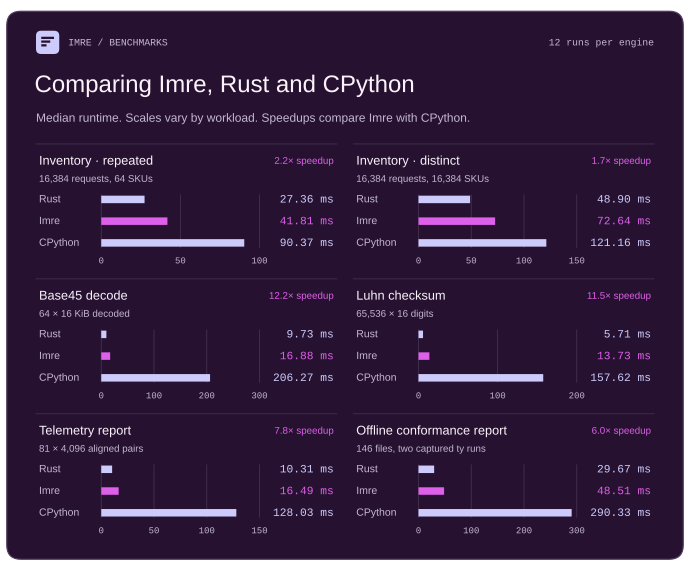

#  Imre

An experimental ahead-of-time compiler for typed Python, written in Rust.

> [!WARNING]
> This README includes human edits; all code changes, PR summaries, and additional
> documentation were authored entirely by GPT-6 Astra in [Codex](https://openai.com/codex/).
>
> Imre implements only a small part of Python and its standard library,
> with no guarantee of future development or maintenance. Use at your own risk.

## Benchmarks

<p align="center">
  
</p>

Imre and CPython 3.14.5 run the same Python programs. The Rust versions use
the same inputs and produce the same outputs. Each bar shows the median time
for 12 fresh processes pinned to one AMD EPYC Milan CPU.

<p align="center">
  
</p>

The frozen Flask app compiles its routes and Jinja template ahead of time.
Node.js, Bun and Rust/Hyper implement the same routes directly.

## Hello, world!

```python
# hello.py
def greet(name: str) -> str:
    return f"Hello, {name}!"


print(greet("world"))
```

On Apple Silicon macOS or 64-bit Linux, build and run the executable.

```console
$ imre build hello.py
$ ./hello
Hello, world!
```

Or run directly, as native code:

```console
$ imre hello.py
Hello, world!
$ imre -I -B -c 'import sys; print(sys.implementation.name)'
imre
$ uv python find imre
/path/to/bin/imre
$ uv run --python imre hello.py
Hello, world!
```

## Language support

Imre compiles a restricted subset of Python into native executables that run
without a Python installation. This program prints the names of everyone who
scored at least eight points, in alphabetical order.

```python
from dataclasses import dataclass


@dataclass
class Result:
    name: str
    score: int


def finalists(results: list[Result], cutoff: int) -> list[str]:
    return sorted(result.name for result in results if result.score >= cutoff)


results = [Result("Mira", 8), Result("Jo", 4), Result("Ada", 10)]
print(", ".join(finalists(results, 8)))  # Ada, Mira
```

Imre can resolve `result.name` and `result.score` at compile time. If you add
the loop below, CPython prints `Mira` and `8`. Imre rejects this use of
`getattr` because the loop chooses the field by name at runtime.

```python
for field in ["name", "score"]:
    print(getattr(results[0], field))
```

At present, Imre doesn't support any of the following:

- Dynamically typed storage (`Any`) and unrestricted unions
- Dynamic attributes and general-purpose reflection
- Recursive calls and async generators
- Most of the Python standard library (see [module coverage](docs/stdlib.md))

At the same time, Imre is capable of running scripts like
[ty’s conformance report](examples/conformance_report/README.md) unchanged,
with Rust-competitive performance.

## Standard library test results

The table covers 25 standard library modules as of November 2, 2026 (UTC).
A **paired pass** means the same original CPython 3.14.5 test passed at both
`-O0` and `-O3`. Counts include selected tests and results from development
branches. Skipped tests count toward the suite size only.

| Module | Paired passes | Upstream tests | How the tests ran |
| --- | ---: | ---: | --- |
| `argparse` | 1,758 | 1,893 | All 14 original TestParentParsers cases passed at O0 and O3 on a guarded integration, adding 14 distinct cases. The projection preserved the complete class, decorators, helpers and module teardown. Stock also passed all 14 inside the unchanged module. Earlier whole-run and selected cases account for the other 1,744. |
| `collections` | 598 | 659 | On public 22945310, the two accelerated OrderedDict classes completed 116 originals and shared 98 stock-matching native passes at O0 and O3. Four were new to the ledger. The remaining 18 included 10 failures, two errors, and six native skips. |
| `csv` | 122 | 128 | Complete suite on `main`, 122 passed and six matched upstream skips. |
| `dataclasses` | 247 | 276 | The latest intact public run passed 206, and the retained intact run passed 207. Thirteen more TestDocString originals pass on a sealed development tree after all 276 register. Their public replay needs annotationlib.get_annotations for #3578. |
| `datetime` | 651 | 1,098 | The intact development build passed 628 of 1,098 originals at both levels. Separate focused runs include 85 of 89 numeric cases on public Linux. Replaying 23 Fast originals on another public build added eight parent successes. Fourteen parents errored and one had 39 subtest errors. |
| `fnmatch` | 24 | 24 | Complete suite on `main`, all 24 passed. |
| `functools` | 91 | 329 | The intact 325-case primary module passed 89 in all four modes. Two more original cases passed in separate runs. |
| `hashlib` | 76 | 82 | With eight official vector files, 74 of the 82 original cases passed on stock and in ordinary and boxed O0 and O3 on public 928de797. The default empty-resource profile had 63 paired passes. Four SHA3 vector cases, two keyed BLAKE2 vector cases and the 4 GiB update bring the cross-revision union to 76. |
| `importlib` | 235 | 1,346 | With the pinned zipfile extension available, Linux native O0 and O3 passed 125 of 126 disk-resource originals, adding 12 text, bytes and encoding cases. The last requires c_resources. Default staging reached zero of these 126. The ledger also includes 86 runnable originals across three intact importlib.metadata files. |
| `io` | 193 | 1,038 | On public Linux, the complete 44-case CBufferedReaderTest class produced 33 stock-matching parent successes at O0 and O3. The 43-case CBufferedWriterTest class added 30 across two builds of one public merge. All 63 were new to the named ledger. The 36-case test_file companion separately passed 20 in all four native configurations. |
| `itertools` | 112 | 138 | Selected runs account for 112 original passes. Public 90955053 resolved the typing.Iterable import. The unchanged 137-case primary now reaches a module-level type alias in _pyrepl/types.py and stops before discovery at both native levels. A separate GIL companion supplies the 138th registration. |
| `json` | 134 | 216 | All 36 selected encoder originals now pass at O0 and O3 on public main, including TestPyEnum.test_floats. All 36 were already credited. The full suite contains 216 originals. |
| `logging` | 95 | 272 | All 272 logging originals registered in pinned order on public Linux. Three named ConfigDictTest originals then ran with their own fixtures and passed on stock and native O0/O3. A separate four-configuration file-handler run passed 36 of 37. Its named-pipe rollover case still errored. |
| `os` | 137 | 579 | All 50 stock walk and fwalk originals ran in the four projected upstream classes. At O0 and O3, public Linux passed 20 and skipped 30 while os.fwalk was unavailable. A later public build passed the bytes fwalk descriptor-finalization original. The two runs added 17 after the first four walk cases. |
| `pathlib` | 673 | 1,369 | The intact 1,369-case run completed 588 parents at O0 and 628 at O3 in the frozen checkpoint, contributing 114 new paired passes. In a separate public run, all 239 PurePath originals completed. Both levels passed 180, matched 56 stock skips and errored on three Windows-flavour cases. Four Python 3.13 pickle cases now pass. |
| `re` | 136 | 165 | The unchanged 165-case file completed on public ab6da8b9 with live stdin. O0 and O3 each passed 97, errored on 41, failed 13 and skipped 14. Stock passed 162 and skipped three. The intact run adds test_misuse_flags to the previously published 135-case union. [Split and substitution results](benchmarks/cpython_stdlib/full/re/split-subn-linux.tsv) |
| `shutil` | 89 | 223 | The complete original TestCopyTree, TestMove and TestCopyFile classes passed all 44 Linux-runnable cases on public main, with two matching skips. Sixteen of the passes were already counted. Earlier sendfile and archive results are included. |
| `socket` | 61 | 746 | Earlier and focused cases total 61. Four native modes pass 14/19 resolver originals, including the new service database lookup. The 746-case discovery run executed no test bodies. |
| `subprocess` | 246 | 353 | All 353 originals completed on public 6683e30c. O0 passed 245 and O3 passed 244. All 244 common native passes have a stock match, including two that require an installed Python. Both native runs skipped 46. O3 timed out in the qcat/qgrep pipe check. Two earlier focused passes bring the cumulative count to 246. |
| `tempfile` | 103 | 118 | The intact 118-case file previously passed 100 originals in ordinary and boxed O0 and O3. Three TemporaryDirectory shutdown cases then passed on stock, the reviewed head and a merge check at O0 and O3. One also passed both levels on public 302ec229. These selected replays bring the union to 103. |
| `textwrap` | 68 | 68 | Complete suite on `main`, all 68 passed. |
| `threading` | 83 | 228 | All 228 original registrations ran in ordinary and boxed builds at both levels. Each passed 83, skipped 32 and reported failures on 113 IDs. The bound worker callback still blocks 58 Bunch fixture cases. |
| `typing` | 107 | 712 | The complete TypedDictTests class passed all 32 originals. The complete NamedTupleTests class rose from 5 to 11 of 21 on public cb36e804 at both native levels. The historical 107 lacks a case-level inventory, so the class gains are reported separately. |
| `unittest` | 275 | 1,090 | The intact package passed 160 cases. On public #3601, the unchanged test_assertions and test_case files ran all 150 originals with runtime imports. Their 109 paired passes added 81 distinct cases. Another 34 original mock methods passed in focused runs. |
| `urllib` | 169 | 178 | Both unchanged scripts ran all 178 originals with zero failures or errors across 16 default invocations on Linux and macOS. They produced 167 literal parent matches and two more after verified address normalization. Three had matching subtests only. Two Windows skips matched stock and four HTTP tests skipped for missing SSL. Both checked builds passed with runtime imports. Ordinary checked compilation still stopped on both files. |
| **Total** | **6,483** | **13,328** | **3 complete suites on `main`** |

See the [standard library coverage report](docs/stdlib.md) for the Linux test
results and import coverage recorded in this repository.

## Design

Types are part of Imre's compilation contract: variables, containers, and class
fields have known types, and each function has one declared or inferred
signature. This lets Imre choose concrete representations. It aims to preserve
Python's behavior for supported operations, including arbitrary-precision integers.

Imre's runtime uses reference counting and restricts object graphs to avoid
cycles. Compiled programs run without a Python installation. Their imports must
use supported Python or native extensions rebuilt against Imre’s `Python.h`.

Other projects make different trade-offs:

- [PyPy](https://pypy.org/) optimizes dynamic Python with a JIT as the program
  runs. It supports much more of Python, but needs time to warm up.
- [Codon](https://docs.exaloop.io/) also compiles Python ahead of time. It can
  specialize functions for different argument types and can call CPython
  explicitly. Its default `int` is 64-bit.
- [Static Python](https://facebookincubator.github.io/cinderx/static-python) and
  [mypyc](https://mypyc.readthedocs.io/) use types to optimize code running
  within CPython, so compiled modules can interact with ordinary Python code.

Use [`@imre.struct`](docs/subset.md#immutable-value-structs) for a record
whose fields are read-only `float` or `bool` values. Imre can store each
point’s `x` and `y` coordinates directly in a `list[Point]`, without allocating
a separate object for each point. Replacing a list entry leaves the original
point intact.

```python
import imre


@imre.struct
class Point:
    x: float
    y: float


points: list[Point] = [Point(1.0, 2.0)]
original = points[0]
points[0] = Point(3.0, 4.0)
print(original.x)  # 1.0
print(points[0].x)  # 3.0
```

For more, see the [design](docs/design.md) and [supported subset](docs/subset.md).

## Installation

Install Imre on Linux or Apple Silicon macOS with the standalone installer.

```sh
curl --proto '=https' --tlsv1.2 -LsSf https://labs.astral.sh/imre/install.sh | sh
```

The x86-64 and ARM64 Linux releases include Clang 18, LLD 18, and the native
link inputs that `imre build` and `imre run` need.

To build from source, use the [Rust toolchain](rust-toolchain.toml).

```console
git clone https://github.com/viarius-experiments/imre.git
cd imre
cargo build --workspace --release --locked
./target/release/imre --version
```

## Getting started

Given `totals.py`:

```python
from sys import argv


def total(quantities: list[int]) -> int:
    result = 0
    for quantity in quantities:
        result += quantity
    return result


print(f"Total: {total([int(value) for value in argv[1:]])}")
```

Compile and run it in one command.

```console
imre run totals.py -- 10 20 12
# Output: Total: 42
```

Use `imre check --watch totals.py` to see diagnostics as you edit the script or its imports.

Use `imre build` to create a native executable in the current directory. You can then run `./totals` directly.

```console
imre build totals.py
./totals 10 20 12
# Output: Total: 42
```

## License

Imre is licensed under either of

- Apache License, Version 2.0, ([LICENSE-APACHE](LICENSE-APACHE) or
  <https://www.apache.org/licenses/LICENSE-2.0>)
- MIT license ([LICENSE-MIT](LICENSE-MIT) or <https://opensource.org/licenses/MIT>)

at your option.

Vendored example code retains its original license; the Base45 codec uses
[BSD-2-Clause](examples/base45_codec/upstream/LICENSE), and the Luhn checksum
library uses its [upstream license](examples/luhn_checksum/upstream/LICENSE).

Unless you explicitly state otherwise, any contribution intentionally submitted for inclusion in Imre
by you, as defined in the Apache-2.0 license, shall be dually licensed as above, without any
additional terms or conditions.
